# r2d2-helmet

A project for an R2D2 costume helmet.

(pls dont sue me, Mr. Mouse)

---

## Hardware

| Part                   | PID  | Role                                  |
| ---------------------- | ---- | ------------------------------------- |
| Adafruit KB2040        | 5302 | RP2040 MCU, Pro Micro form factor     |
| Breadboard NeoPixel ×2 | 1312 | SK6812, dome lighting behind diffuser |
| STEMMA Speaker         | 3885 | PAM8302A class-D + 1 W 8 Ω speaker    |
| 1.9" 320×170 IPS TFT   | 5394 | ST7789, logic display panel           |
| TowerPro SG92R servo   | 169  | 9 g micro servo, periscope hinge      |

Passives: 2× 1 kΩ, 2× 10 nF, 1× 470 Ω, 1× 100 µF electrolytic, and **two** bulk electrolytics — one at the amp (**1000 µF as built**) and one at the servo (470 µF or more).

**The servo requires bypassing `RAW`'s 500 mA polyfuse** — see [Power](#power) below. Do this before wiring it. Plus **two** momentary pushbuttons (normally open) — no resistors needed, the RP2040's internal pull-ups handle both.

Powered from a **USB power bank** into the KB2040's USB-C.

The 5394 ships with a 1×11 0.1" header strip. Solder it and breadboard directly — the EYESPI FPC connector alongside it carries the same signals and goes unused, so no EYESPI breakout or cable is needed.

### 5394 display header, pad 1 → 11

Order verified against the net list in Adafruit's Eagle board file (`JP1`) and cross-checked against the guide's own breadboard wiring list. **Note `MISO` comes before `MOSI`** — the reverse of most Adafruit breakouts.

| # | Silk   | Signal                                          |
| - | ------ | ----------------------------------------------- |
| 1 | `Vin`  | 3–5 V in — onboard LDO + level shifter          |
| 2 | `3V`   | 3.3 V regulator **output**, ≥100 mA — leave free |
| 3 | `Gnd`  | ground                                          |
| 4 | `SCK`  | SPI clock                                       |
| 5 | `MISO` | microSD only — **not used**, TFT is write-only   |
| 6 | `MOSI` | SPI data in                                     |
| 7 | `TCS`  | TFT chip select                                 |
| 8 | `RST`  | TFT reset (auto-reset circuit onboard)          |
| 9 | `DC`   | TFT data/command select                         |
| 10 | `SDCS` | microSD chip select — **not used**             |
| 11 | `Lite` | backlight enable — **pulled high, leave unconnected** |

---

## Wiring

### Board pin geometry

The KB2040 is Pro Micro shaped: 12 castellated pads per edge, USB-C at the top.

```
              USB-C
        ┌───────────────┐
  D0/TX │1           24│ RAW      <- 5V from USB, 500mA polyfuse
  D1/RX │2           23│ GND
    GND │3           22│ RST
    GND │4           21│ 3V       <- 3.3V reg out, 500 mA
     D2 │5           20│ A3
     D3 │6           19│ A2
     D4 │7           18│ A1
     D5 │8           17│ A0
     D6 │9           16│ SCK
     D7 │10          15│ MISO
     D8 │11          14│ MOSI
     D9 │12          13│ D10
        └───────────────┘
         STEMMA QT on end (GP12/GP13)
```

`D2` and `D3` are pins 5 and 6, immediately below the two `GND` pads at pins 3 and 4 — which is why both buttons land there. Each is a two-pad hop rather than a wire across the board.

### Full schematic

```mermaid
flowchart TB

  %% ============ POWER ============
  subgraph PWR["⚡ Power rails"]
    direction TB
    USB["USB-C<br/>5 V in"]
    RAW["RAW pin<br/><b>5 V</b> · fused 500 mA–1 A"]
    V3["3V pin<br/><b>3.3 V</b> · 500 mA total<br/><i>incl. the MCU itself</i>"]
    GND(["GND<br/><b>common — tie all together</b>"])
    USB --> RAW
    RAW -->|"onboard LDO"| V3
  end

  %% ============ MCU ============
  subgraph MCU["🧠 Adafruit KB2040 · RP2040 @ 133 MHz"]
    direction TB
    P_D8["<b>D8</b> · GP8<br/>PWM slice 4A"]
    P_D5["<b>D5</b> · GP5"]
    P_SCK["<b>SCK</b> · GP18"]
    P_MOSI["<b>MOSI</b> · GP19"]
    P_D7["<b>D7</b> · GP7"]
    P_D4["<b>D4</b> · GP4"]
    P_D10["<b>D10</b> · GP10"]
    P_D2["<b>D2</b> · GP2"]
    P_D6["<b>D6</b> · GP6"]
    P_D3["<b>D3</b> · GP3"]
  end

  %% ============ AUDIO ============
  subgraph AUD["🔊 Audio chain"]
    direction LR
    R1["R1<br/>1 kΩ"]
    N1(("node A"))
    C1["C1<br/>10 nF"]
    R2["R2<br/>1 kΩ"]
    N2(("node B"))
    C2["C2<br/>10 nF"]
    CB1["C_bulk<br/>1000 µF"]
    subgraph SPK["STEMMA Speaker 3885 · PAM8302A"]
      direction TB
      S_SIG["<b>SIG</b> pad / white wire<br/>0–3 V in · AC-coupled 1.0 µF onboard"]
      S_VCC["<b>+</b> pad / red wire<br/>3–5 V"]
      S_GND["<b>−</b> pad / black wire"]
      S_POT["🔧 volume trim pot<br/><b>start at minimum</b>"]
      S_OUT["1 W 8 Ω speaker<br/>~250 kHz class-D switching"]
      S_SIG --> S_POT --> S_OUT
    end
  end

  P_D8 -->|"PWM carrier 130 kHz<br/>22.05 kS/s"| R1
  R1 --> N1
  N1 --> C1
  C1 --> GND
  N1 --> R2
  R2 --> N2
  N2 --> C2
  C2 --> GND
  N2 -->|"filtered audio<br/>2-pole, fc ≈ 15.9 kHz"| S_SIG
  RAW -->|"5 V"| S_VCC
  RAW --> CB1
  CB1 --> GND
  S_GND --> GND

  %% ============ NEOPIXELS ============
  subgraph NPX["💡 NeoPixel chain · 2× SK6812"]
    direction LR
    R3["R3<br/>470 Ω"]
    CB2["C_bulk<br/>100 µF"]
    NP1["Pixel 1<br/>DIN→DOUT"]
    NP2["Pixel 2<br/><i>DOUT unused</i>"]
    NP1 -->|"DOUT→DIN"| NP2
  end

  P_D5 -->|"800 kHz data<br/>3.3 V logic"| R3
  R3 -->|"to DIN of pixel 1"| NP1
  V3 -->|"<b>3.3 V — not 5 V</b><br/>drops V_IH to 2.31 V"| CB2
  CB2 --> NP1
  CB2 --> GND

  %% ============ DISPLAY ============
  subgraph DISP["🖥️ Logic display · Adafruit 5394"]
    direction TB
    subgraph HDR["1×11 0.1in header · solder the included strip"]
      direction TB
      E_VIN["1 · <b>Vin</b>"]
      E_3V["2 · <b>3V</b><br/><i>regulator OUT — leave free</i>"]
      E_GND["3 · <b>Gnd</b>"]
      E_SCK["4 · <b>SCK</b>"]
      E_MISO["5 · <b>MISO</b><br/><i>no microSD — unwired</i>"]
      E_MOSI["6 · <b>MOSI</b>"]
      E_TCS["7 · <b>TCS</b>"]
      E_RST["8 · <b>RST</b>"]
      E_DC["9 · <b>DC</b>"]
      E_SDCS["10 · <b>SDCS</b><br/><i>no microSD — unwired</i>"]
      E_LITE["11 · <b>Lite</b><br/><i>pulled high — leave floating</i>"]
    end
    TFT["1.9in 320×170 IPS · ST7789<br/>visible area 46 × 25 mm<br/>onboard 3.3 V LDO + 3/5 V level shifter<br/>microSD slot<br/><i>EYESPI FPC connector unused</i>"]
    HDR ==>|"same board"| TFT
  end

  P_SCK  -->|"8–12 MHz to start"| E_SCK
  P_MOSI --> E_MOSI
  P_D7   --> E_DC
  P_D4   --> E_RST
  P_D10  --> E_TCS
  V3     -->|"3.3 V"| E_VIN
  E_GND  --> GND

  %% ============ BUTTONS ============
  subgraph BTN["🔘 Buttons · both normally open"]
    SW1["<b>Button 1 — mode</b><br/>toggles active / standby"]
    SW2["<b>Button 2 — trigger</b><br/>fires one interaction"]
  end

  %% ============ SERVO ============
  subgraph SRV["🔭 Periscope · TowerPro SG92R"]
    direction TB
    S_SIG2["<b>signal</b> · orange<br/>50 Hz, 500–2500 µs"]
    S_PWR["<b>V+</b> · red<br/>4.8–6 V · 650 mA stall"]
    S_GND2["<b>GND</b> · brown"]
    CB3["C_bulk<br/>470 µF"]
  end

  P_D6 -->|"PIO-generated pulse train"| S_SIG2
  RAW -->|"<b>fuse must be bypassed</b>"| S_PWR
  RAW --> CB3
  CB3 --> GND
  S_GND2 --> GND

  P_D2 -->|"INPUT_PULLUP<br/>reads LOW when pressed"| SW1
  P_D3 -->|"INPUT_PULLUP<br/>reads LOW when pressed"| SW2
  SW1 --> GND
  SW2 --> GND

  classDef pwr fill:#4a2c00,stroke:#ffa726,stroke-width:2px,color:#ffe0b2
  classDef mcu fill:#00332b,stroke:#26a69a,stroke-width:2px,color:#b2dfdb
  classDef aud fill:#3a0d2e,stroke:#ec407a,stroke-width:2px,color:#f8bbd0
  classDef npx fill:#0d2137,stroke:#42a5f5,stroke-width:2px,color:#bbdefb
  classDef dsp fill:#1a2e05,stroke:#9ccc65,stroke-width:2px,color:#dcedc8
  classDef btn fill:#33291a,stroke:#ffb74d,stroke-width:2px,color:#ffe0b2
  classDef srv fill:#2b1a33,stroke:#ba68c8,stroke-width:2px,color:#e1bee7
  class USB,RAW,V3,GND pwr
  class P_D8,P_D5,P_SCK,P_MOSI,P_D7,P_D4,P_D10,P_D2,P_D3,P_D6 mcu
  class R1,R2,C1,C2,N1,N2,CB1,S_SIG,S_VCC,S_GND,S_POT,S_OUT aud
  class R3,CB2,NP1,NP2 npx
  class E_VIN,E_3V,E_GND,E_SCK,E_MOSI,E_MISO,E_DC,E_RST,E_TCS,E_SDCS,E_LITE,TFT dsp
  class SW1,SW2 btn
  class S_SIG2,S_PWR,S_GND2,CB3 srv
```



### Connection table

Wire it from this, not from the diagram — the diagram shows topology, this shows nets.

**Audio**

| From               | To                                           |
| ------------------ | -------------------------------------------- |
| KB2040 `D8` (GP8)  | R1 (1 kΩ) leg 1                              |
| R1 leg 2           | node A — R2 leg 1, and C1 (10 nF) leg 1      |
| C1 leg 2           | GND                                          |
| R2 leg 2           | node B — C2 (10 nF) leg 1, and speaker `SIG` |
| C2 leg 2           | GND                                          |
| KB2040 `RAW` (5 V) | speaker `+` (red), and C_bulk 1000 µF `+`    |
| C_bulk 1000 µF `−` | GND                                          |
| KB2040 `GND`       | speaker `−` (black)                          |

STEMMA Speaker JST PH 3-pin: **white = SIG, red = +, black = −**. The same three signals are on the large alligator/sew pads, labelled `SIG` / `+` / `−`.

**NeoPixels**

| From              | To                                                      |
| ----------------- | ------------------------------------------------------- |
| KB2040 `D5` (GP5) | R3 (470 Ω) leg 1                                        |
| R3 leg 2          | pixel 1 `DIN` — **pixel 1 is the FRONT PSI**            |
| KB2040 `3V`       | pixel 1 + 2 `+` (in parallel), and C_bulk 100 µF `+`    |
| KB2040 `GND`      | pixel 1 + 2 `−` (in parallel), and C_bulk 100 µF `−`    |
| pixel 1 `DOUT`    | pixel 2 `DIN` — pixel 2 is the REAR PSI                 |
| pixel 2 `DOUT`    | leave unconnected                                       |

Each pixel has 3 pads per side; the two sides mirror each other except that data is `DIN` on one side and `DOUT` on the other. Power and ground are common across both sides, so you can daisy-chain in either direction.

**Chain order decides which PSI is which.** The pixel wired directly to `D5` through the 470 Ω is the front (red/blue); the one hanging off its `DOUT` is the rear (green/yellow). If that ends up backwards on the costume, swap `PIXEL_FRONT` and `PIXEL_REAR` in `src/config.h` rather than resoldering.

**Display** — 5394 header straight into the breadboard, wire by silkscreen label:

| 5394 pad | KB2040                                                  |
| -------- | ------------------------------------------------------- |
| `Vin`    | `3V`                                                    |
| `3V`     | **leave unconnected** — this is an output, not an input  |
| `Gnd`    | `GND`                                                   |
| `SCK`    | `SCK` (GP18)                                            |
| `MISO`   | **leave unconnected** — no microSD in this build         |
| `MOSI`   | `MOSI` (GP19)                                           |
| `TCS`    | `D10` (GP10)                                            |
| `RST`    | `D4` (GP4)                                              |
| `DC`     | `D7` (GP7)                                              |
| `SDCS`   | **leave unconnected** — no microSD in this build         |
| `Lite`   | **leave unconnected** — pulled high, backlight full on  |

Seven wires total. The EYESPI FPC connector carries these same signals and stays empty.

**Periscope servo**

| From               | To                                          |
| ------------------ | ------------------------------------------- |
| KB2040 `D6` (GP6)  | servo signal (**orange**)                   |
| KB2040 `RAW` (5 V) | servo `V+` (**red**), and C_bulk 470 µF `+` |
| C_bulk 470 µF `−`  | GND                                         |
| KB2040 `GND`       | servo `GND` (**brown**)                     |

SG92R wire colours: **orange = signal, red = V+, brown = ground.** Note this is not the same convention as the STEMMA speaker — brown, not black, is ground here.

**`RAW`'s polyfuse must be bypassed first** (see [Power](#power)), and run the servo's ground back to the same point as everything else with as short and thick a wire as you can. Its current spikes go home through that wire, and a long thin one turns them into a voltage wobble that every other subsystem sees.

**Buttons**

| From              | To                                        |
| ----------------- | ----------------------------------------- |
| KB2040 `D2` (GP2) | button 1 (**mode**) leg 1                 |
| button 1 leg 2    | `GND`                                     |
| KB2040 `D3` (GP3) | button 2 (**trigger**) leg 1              |
| button 2 leg 2    | `GND`                                     |

Both `INPUT_PULLUP`, so each pin idles high and reads LOW when pressed. No pull-up resistors and no debounce caps — debouncing is done in software.

Button 1 toggles active mode: screen and lights animate, periscope moves when it exists, and it stays silent. Button 2 fires a one-off interaction with sound. Full behaviour model is in [`CLAUDE.md`](CLAUDE.md).

Note this consumes `Wire1`. If I2C is ever needed, use the STEMMA QT port (`Wire0`, GP12/GP13), which stays free and needs no soldering.

---

## Power

Everything on `RAW` runs through a **500 mA polyfuse**, including the 3.3 V regulator. Adding the servo puts it well over:

| Load | Draw |
| --- | --- |
| 3.3 V rail (display, pixels, MCU) via the LDO | ~180 mA |
| Speaker amp | ~350 mA on transients |
| SG92R servo | ~150 mA moving, **650 mA stalled** |
| **Worst case** | **~1180 mA** |

The fix is on the back of the KB2040: **close the `USB+ → RAW` solder jumper.** That bypasses the fuse and allows up to 2 A from USB. The power bank's own protection takes over from the board's.

Then fit the 470 µF across the servo's supply, right at the servo. Its inrush is what browns out everything else, and the cap supplies that locally instead of pulling it down a wire.

A stall is the case that matters — 650 mA sustained, drawn until something moves or breaks. Keep `PERISCOPE_ANGLE_MIN` / `MAX` inside whatever the hinge mechanically allows so the horn never drives into a hard stop.

---

## Before you power it on

- **Tie every ground together** — MCU, speaker, pixels, display. A floating amp ground is the most common reason a PWM audio path hums or does nothing.
- **Turn the speaker trim pot to minimum.** Gain is a fixed 24 dB; 3.3 V p-p with the pot up will clip hard into a 1 W speaker.
- **Close the `USB+ → RAW` jumper** on the back of the KB2040 before wiring the servo. Without it the polyfuse trips under load.
- **Fit both bulk caps** — 1000 µF at the amp, 470 µF at the servo. Class-D transients sag `RAW` enough to brown out the MCU, and it only shows up once audio and lights run together.
- **Check pixel `V+` goes to `3V`, not `RAW`.** This is what lets 3.3 V logic drive them without a level shifter.
- **Support the display panel mechanically.** Adafruit's warning: 5394 was designed for smartwatches where cover glass retains it, and "without something gently holding the screen down, the backlight can eventually peel away from the TFT." The dome faceplate needs to press lightly on the display face.

---

## Reference

The electrical reasoning behind these choices, the full GPIO and PWM slice map, the power budget, and the filter response analysis live in [`.claude/skills/hardware/`](.claude/skills/hardware/SKILL.md).

- [`.claude/skills/firmware/`](.claude/skills/firmware/SKILL.md) — PlatformIO, the arduino-pico core, build and flash, the dual-core split
- [`.claude/skills/r2-sounds/`](.claude/skills/r2-sounds/SKILL.md) — how the voice was made and how to synthesize it
- [`.claude/skills/bring-up/`](.claude/skills/bring-up/SKILL.md) — first-power-on order and failure signatures
- [`CLAUDE.md`](CLAUDE.md) — project state, feature scope, and the rules that must not be broken
